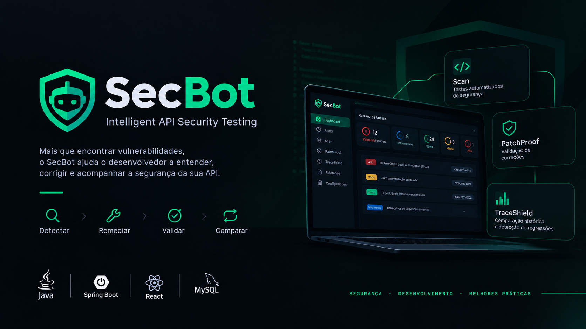

# SecBot — Intelligent API Security Testing

  

**SecBot** é uma ferramenta web em desenvolvimento que tem como objetivo auxiliar desenvolvedores na identificação de vulnerabilidades em APIs, na validação de correções e na detecção de regressões de segurança.

O projeto está sendo desenvolvido como Trabalho de Conclusão de Curso (TCC), com foco em **DevSecOps, Security by Design e Shift-Left Security**.

A proposta vai além de identificar possíveis vulnerabilidades: o SecBot busca ajudar o desenvolvedor a compreender os problemas encontrados, verificar se as correções funcionam e acompanhar a evolução da segurança da aplicação.

> **Status:** Em desenvolvimento — MVP.

## Objetivos

- Automatizar testes de segurança em APIs web.
- Identificar falhas de autenticação, autorização e outras vulnerabilidades relevantes.
- Registrar evidências e resultados dos testes para facilitar a análise.
- Auxiliar na validação de correções de segurança.
- Comparar resultados de diferentes análises para identificar regressões.
- Incentivar a aplicação de práticas de segurança desde as primeiras etapas do desenvolvimento.

## Módulos

### SecBot Scan
Responsável pela execução de testes automatizados de segurança, identificação de possíveis vulnerabilidades e registro das evidências encontradas.

### PatchProof
Voltado à validação de correções, permitindo verificar se uma vulnerabilidade identificada anteriormente foi efetivamente corrigida.

### TraceShield
Responsável pela comparação histórica dos resultados de segurança, auxiliando na identificação de vulnerabilidades recorrentes e regressões introduzidas durante a evolução da aplicação.

## Como funciona

O fluxo proposto para a ferramenta é:

1. **Cadastrar:** configurar a aplicação ou API que será analisada.
2. **Testar:** executar os testes de segurança definidos para o alvo.
3. **Detectar:** analisar os resultados e registrar possíveis vulnerabilidades.
4. **Remediar:** consultar informações sobre os problemas identificados e orientar sua correção.
5. **Validar:** executar novos testes para verificar as correções.
6. **Comparar:** confrontar os resultados anteriores e atuais para identificar regressões.

## Tecnologias

| Tecnologia | Aplicação |
|---|---|
| Java | Linguagem principal do backend |
| Spring Boot | API e lógica de negócio |
| Spring Security | Segurança e controle de acesso |
| React | Interface web e dashboard |
| MySQL | Persistência de dados |
| Git e GitHub | Versionamento e gerenciamento do código |

## Escopo de segurança

A proposta contempla testes relacionados a categorias de vulnerabilidades reconhecidas pela comunidade de segurança, utilizando o **OWASP Top 10** como uma das referências para a definição do escopo.

Entre os cenários previstos estão:

- Falhas de autenticação e tentativas excessivas de login (*brute force*).
- Problemas de autorização e acesso indevido a recursos.
- Vulnerabilidades do tipo BOLA/IDOR.
- Verificações relacionadas a tokens JWT, quando aplicáveis.
- Validação de correções e identificação de regressões.

A cobertura efetiva dependerá da implementação e dos testes realizados durante o desenvolvimento.

## Arquitetura proposta

O projeto separa a ferramenta SecBot da API utilizada como alvo de testes.

- **SecBot:** aplicação responsável pela configuração dos alvos, execução das análises, armazenamento dos resultados e apresentação das evidências.
- **API de laboratório:** aplicação independente utilizada para desenvolver e validar os testes em cenários controlados, incluindo casos vulneráveis e suas respectivas correções.

Essa separação permite avaliar o comportamento dos testes sem confundir a ferramenta de análise com a aplicação analisada.

## Segurança e uso responsável

O SecBot está sendo desenvolvido para fins educacionais, de pesquisa e de apoio ao desenvolvimento seguro de software.

Os testes devem ser executados somente em aplicações próprias, ambientes de laboratório ou sistemas para os quais exista autorização explícita. A API de laboratório será utilizada para validar os cenários de teste de maneira controlada.

## Desenvolvimento

O projeto está em fase de implementação. O desenvolvimento prioriza inicialmente o cadastro de alvos, a configuração das regras de teste, a execução das análises e a persistência de evidências e resultados.

As funcionalidades de orientação de correções, validação pós-correção e detecção de regressões serão desenvolvidas e avaliadas progressivamente.

## Contexto acadêmico

Projeto desenvolvido como Trabalho de Conclusão de Curso do curso de Tecnologia em Sistemas para Internet, no Instituto Federal de Educação, Ciência e Tecnologia de São Paulo (IFSP).

O SecBot busca explorar como a automação de testes de segurança pode contribuir para a identificação precoce de vulnerabilidades e para a melhoria contínua da segurança de APIs.

---

**SecBot — Detectar. Remediar. Validar. Comparar.**
